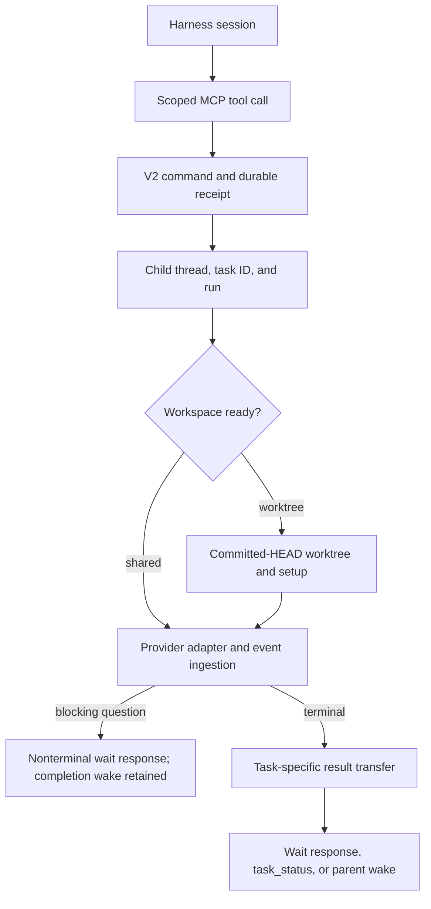

# Orchestrator MCP Server

## Purpose

T3 exposes V2 orchestration through its app-owned MCP endpoint. A provider
agent can use this endpoint to:

- create an app-owned sub-agent on any supported provider instance;
- wait for or poll the sub-agent's durable result;
- cancel an active delegated task; and
- create one or more ordinary top-level T3 threads;
- list a project's threads and incrementally read any thread;
- rename threads, regenerate titles, and link or unlink pull requests;
- send or steer follow-up messages; and
- wait for or interrupt ordinary thread runs.

These are T3 orchestration operations, not provider-native sub-agent APIs.
Delegated tasks always create a T3 child thread and run. The child receives
only the supplied task prompt, plus an optional role instruction supplied in
the same tool call. Parent conversation history is not copied into the child.

`ThreadManagementService` is the shared server application boundary for V2
WebSocket commands and MCP. It owns thread lookup, listing, send-mode
selection, durable send postconditions, wait polling, and interrupt selection;
`OrchestratorV2` remains the lower-level command/event processor. Transport
adapters only authenticate, resolve transport-specific inputs, and shape
responses.

## Transport And Authentication

The orchestration tools share the existing authenticated HTTP MCP endpoint:

```text
http://127.0.0.1:<server-port>/mcp
```

The provider-visible server key is `t3-code`. The endpoint registers both the
preview toolkit and the orchestration toolkit.

Before `ProviderSessionManager` opens a new V2 provider session, it asks
`McpSessionRegistry` for a credential scoped to:

- the T3 environment;
- the parent T3 thread;
- the concrete provider instance; and
- the provider session.

The credential grants `preview` and `orchestration` capabilities. Credentials
expire after a maximum lifetime, expire when idle, and are revoked when the
provider session is released. The raw token is not persisted in orchestration
state.

The MCP HTTP server resolves the bearer token and supplies the resulting
`McpInvocationScope` to tool handlers. Orchestration handlers additionally
check the `orchestration` capability before reading or mutating state.

Models normally call MCP tools, not a separate session-management CLI. The
internal `t3 acp-mcp-bridge` stdio adapter and
`t3 acp-mcp-call <tool-name> <json>` fallback forward to the same endpoint using
the injected session credentials.

Desktop and web use the same orchestration implementation. Electron launches
the bundled server and renders its bundled web client; there is no separate
desktop tool or RPC allowlist. OMP/Pi MCP extensions are materialized inside
the selected backend's base directory in either app. Desktop builds must be
rebuilt and repackaged to include these changes; a web build does not replace
an already-installed desktop release.

## Provider Injection

### Codex V2

Codex app-server receives the remote MCP server through command-line config
overrides:

```text
-c mcp_servers.t3-code.url=http://127.0.0.1:<port>/mcp
-c mcp_servers.t3-code.bearer_token_env_var="T3_MCP_BEARER_TOKEN"
```

The provider-session token is placed in `T3_MCP_BEARER_TOKEN`. Both the
production Codex launcher and the injectable test launcher use the same
projection helper.

### Claude Agent SDK V2

Claude receives an HTTP MCP server in its query options:

```ts
{
  mcpServers: {
    "t3-code": {
      type: "http",
      url: "http://127.0.0.1:<port>/mcp",
      headers: {
        Authorization: "Bearer <provider-session-token>",
      },
    },
  },
  allowedTools: [
    // existing allowed tools
    "mcp__t3-code__*",
  ],
}
```

The adapter logs only whether MCP configuration exists; it does not log the
server headers or token.

### Cursor Agent SDK V2

Cursor receives the same authenticated HTTP MCP endpoint through the SDK's
`mcpServers` agent and send options. The adapter passes the authorization header
to the SDK but projects only redacted option metadata into protocol diagnostics.

### Grok ACP V2

Grok receives the authenticated HTTP MCP endpoint through the ACP
`session/new`, `session/load`, and `session/fork` `mcpServers` field. The shared
ACP adapter owns standard protocol behavior; the Grok flavor adds xAI extension
requests such as structured user questions.

ACP does not define native subagents or active steering. Grok therefore uses
orchestrator-owned child threads and implements steering through
cancel-and-restart. Its current driver also lacks `session/fork`, so app forks
use portable context transfer. These are orchestrator policies, not
provider-specific MCP tools.

### ACP Registry V2

The `acpRegistry` driver is the generic flavor of the same shared ACP adapter.
Each provider instance names an agent from the official ACP Registry. Settings
searches the registry through the connected server, then prepares a compatible
distribution before persisting the provider instance. Binary distributions use
a managed, versioned cache; declared checksums are verified when present.
Version-pinned `npx` packages install globally through `npm`; `uvx` packages use
`uv tool install`. ACP launches the resulting global command directly, so the
same command is available for terminal authentication. A local executable may
override the installed command without changing the registry-declared arguments
or environment.

Search, preparation, provider status, and session startup share one
server-scoped catalog service. This keeps platform selection and registry
validation identical across settings and runtime use. Catalog inspection never
starts an ACP process, probes models, or performs authentication. The managed
provider snapshot creates a disposable `session/new` through the normal provider
refresh lifecycle, using success as the authentication-readiness proof and
projecting advertised models into the snapshot. Terminal-only login remains a
manual operation on the connected server.

Capabilities such as session loading, session forking, models, modes, and MCP
transport are enabled only when the selected agent advertises them. Missing
features degrade through V2 policy: steering uses interrupt-and-restart,
forking uses portable context when native `session/fork` is unavailable, and
subagents use orchestrator-owned child threads. Registry agents do not receive
provider-specific extensions; those remain in flavors such as Grok.

### Pi V2

Pi core has no MCP client. When a provider session credential exists, the
adapter writes a T3-owned extension into the server cache and spawns
`pi --mode rpc --extension <cache>/pi-t3-mcp-extension.ts` with:

```text
T3_MCP_URL=http://127.0.0.1:<port>/mcp
T3_MCP_BEARER_TOKEN=<provider-session-token>
```

The extension connects to that HTTP endpoint, lists tools, and registers each
one with `pi.registerTool` under a `mcp__t3-code__` namespace
(`mcp__t3-code__delegate_task`, `mcp__t3-code__t3_thread_launch`, and the rest).
The bridge calls the original MCP tool name over HTTP. Follow-up requests send
`mcp-protocol-version: 2025-06-18`; Effect's MCP transport returns 400
without it. The first turn of a session also receives the shared T3
orchestration instructions.

Pi keeps ownership of native extension discovery. T3 does not replace Pi's
`subagent` tool or reproduce Pi's package and project-trust loader. Durable
delegation goes through the namespaced T3 MCP `delegate_task` tool and the
shared orchestration child-thread lifecycle. When Pi's example `subagent`
extension is installed, the adapter observes its documented `details.results`
shape and projects task cards with no child thread id. Unknown result shapes
remain ordinary dynamic tool output.

### OMP V2

OMP uses the same T3-owned extension bridge, launched in RPC mode with the
extension path and scoped MCP environment variables above. Registered tools
appear through OMP's `xd://` routes. Its native MCP support does not require a
second orchestration implementation.

App-owned OMP child sessions support delegation, messaging, reads, waits, and
cancellation through the shared V2 lifecycle. Native OMP subagents remain owned
by OMP; Claude-native workflow stopping is not emulated for other providers.

### Provider Support

A provider instance can run child tasks when its live `ProviderInstance`
exposes a V2 `orchestrationAdapter` — the same registration the orchestrator
resolves when a `delegated_task.request` executes. That covers Codex, Claude
Agent SDK, Cursor Agent SDK, Grok, generic registry agents over ACP, OpenCode,
OpenCode 2, Pi, OMP, Antigravity, and any future driver that builds an adapter.
Capability discovery still reports other registered provider instances, but
marks them unavailable for orchestration when no adapter resolves. This keeps
provider selection model-visible without allowing a request that cannot run.

## Tool Surface

The toolkits expose delegated-task, thread, schedule, and native-workflow controls.

### `orchestrator_capabilities`

Returns:

- the inherited provider instance and model;
- the parent runtime and interaction modes;
- registered provider instances and advertised models;
- whether each provider can run a child task; and
- feature flags for polling, cancellation, and batch thread creation.

Unavailable providers include model-visible constraints such as missing V2
adapter support, disabled state, missing executable, or missing authentication.

### `delegate_task`

Creates a T3-owned child thread and dispatches the supplied task prompt.
`isolation: "shared"` inherits the parent's checkout. With
`isolation: "worktree"`, the child starts in a new worktree at the parent's
committed HEAD, without copying uncommitted tracked edits. Workspace preparation
runs before the provider starts, honoring the configured setup-script completion policy.

```ts
type DelegateTaskInput = {
  task: string;
  target?: {
    providerInstanceId?: string;
    driverKind?: string;
    model?: string;
  };
  title?: string;
  role?: "implementation" | "research" | "review" | "design" | "test" | "general";
  mode?: "async" | "wait";
  isolation?: "shared" | "worktree";
  timeoutMs?: number;
  clientRequestId?: string;
  runtimeMode?: "inherit" | "approval-required" | "auto-accept-edits" | "full-access";
  interactionMode?: "inherit" | "plan" | "default";
};
```

Provider, model, runtime mode, and interaction mode inherit from the parent
when omitted. A driver-only target inherits the parent's provider instance
when it can run child tasks, and otherwise selects an available instance of
that driver; an explicit `providerInstanceId` is honored exactly and fails
when unavailable. Selecting a different provider without a model uses that
provider's first advertised model.

Capability discovery reports each provider's supported `runtimeModes`. Inherited
mode selection steps down to a supported mode within the caller's ceiling.
An explicit unsupported mode, or an inherited ceiling with no supported mode,
is rejected rather than silently escalating.

Task identity is distinct from backing thread identity. Sending a new message
to a completed app-owned child with `t3_thread_send` allocates a fresh `taskId`
while retaining the child session. Track that ID for the follow-up's result;
the original task's published result stays unchanged. Use a distinct
`clientRequestId` per logical follow-up, stable across retries. Restart
continuations retain the task identity they continue.

Delegation requires an active parent run owned by the MCP credential's
provider session. The request becomes the V2 command
`delegated_task.request`.

`mode: "async"` returns the current durable state immediately.
`mode: "wait"` returns on a result, a blocking question, or timeout. A blocking
question sets `hasPendingQuestion: true` without making the task terminal;
inspect and answer it with `t3_pending_request_list`, `t3_pending_request_read`,
and `t3_pending_request_respond` using the child thread ID. Suggested
`initialAnswer` text is preserved when provided. Completion still wakes the
parent after a question releases its wait. A timeout does not cancel the child
and sets `waitTimedOut: true`.

```ts
type DelegateTaskResult = {
  taskId: string;
  childThreadId: string;
  childRunId: string | null;
  childNodeId: string;
  status: "queued" | "running" | "waiting" | "completed" | "failed" | "cancelled" | "interrupted";
  workState: "working" | "waiting_for_children" | "result_available";
  hasPendingChildRuns: boolean;
  hasPendingQuestion: boolean;
  providerInstanceId: string;
  model: string | null;
  summary: string | null;
  resultContextTransferId: string | null;
  latestTerminalRunId: string | null;
  latestTerminalStatus: "completed" | "failed" | "cancelled" | "interrupted" | null;
  latestTerminalSummary: string | null;
  latestTerminalResultContextTransferId: string | null;
  waitTimedOut: boolean;
};
```

### `task_status`

Reads a delegated task from the parent thread's durable projection. A task ID
from another parent thread is rejected. `childRunId` identifies that task's
run, including its current restart continuation. `workState` distinguishes active
work, a finished turn waiting for children, and an available result. The task
remains nonterminal until its known work finishes. Its published `summary` and
result transfer then remain stable across later tasks on the same child thread.
`hasPendingChildRuns` reports later queued or executing turns;
`latestTerminal*` exposes later executed, non-monitor results without replacing
the published task result.

### `task_cancel`

Stops the child thread and its delegated descendants, disposing automatic parent
delivery. Like a user Stop, this interrupts active work, holds queued turns, and
ends pull request watches. The selected task's own queued runs are cancelled,
including held runs; unrelated queued turns remain held rather than cancelled.
Reused child threads are traversed once. A nonterminal task with no stoppable
run is rejected. A terminal task keeps its published status and result while
later work on its child still stops. An optional cancellation reason is accepted.

### `create_threads`

Creates between one and twenty ordinary top-level T3 threads:

```ts
type CreateThreadsInput = {
  threads: Array<{
    prompt?: string;
    title?: string;
    target?: {
      providerInstanceId?: string;
      driverKind?: string;
      model?: string;
    };
    runtimeMode?: "inherit" | "approval-required" | "auto-accept-edits" | "full-access";
    interactionMode?: "inherit" | "plan" | "default";
  }>;
  clientRequestId?: string;
};
```

Each entry independently resolves provider, model, and modes. The new threads
inherit the parent's project, branch, and worktree path, but they have no
sub-agent lineage. Entries with a prompt immediately dispatch a run; entries
without a prompt remain idle.

### `t3_thread_launch`

Launches one ordinary top-level thread through the app's launch service. Use an
explicit `workspaceStrategy` to create a new worktree (`worktree` with `baseRef`),
attach an existing checkout (`existing_worktree` with `worktreePath`), or use the
project root (`root`, also the default). The thread is bound to that workspace
before the agent starts. Creating a worktree in the task prompt does not update
this binding.

Pass the task in `message`. Project, model, and modes inherit when omitted;
workspace does not. `scratch: true` launches without a project, in a folder of
its own under the environment's Scratch project. For stacked PRs, use the parent branch as `baseRef` with
`startFromOrigin: false`. The new thread may not run with broader runtime or
interaction modes than the caller. If the selected provider does not offer a
requested runtime mode, launch is refused; inherited modes step down to the
broadest mode that provider offers within the caller's limit. Launch has no retry
key, so inspect existing threads after a failed or lost response before launching
again. `create_threads` remains the batch option for a shared checkout.

### `t3_thread_list`

Lists durable thread shells in one project, newest first: `projectId` when
given, else the calling thread's project. Callers can filter by title, run
status, and whether app-owned sub-agent threads are included. Results are
bounded and offset-paginated. Deleted threads are never listed.

### `t3_thread_read`

Reads the durable state, recent runs, and visible timeline of any thread in
the environment by thread ID. A deleted thread returns `thread_not_found`. The
default `messages` view returns user messages, assistant
messages, and proposed plans. The `activity` view also returns summarized tool,
reasoning, checkpoint, handoff, and runtime-request items. Large item text is
bounded and reports whether it was truncated. `afterPosition` and
`nextPosition` support incremental reads.
Activity items identifying native or app-owned subagents include `subagentId`.

Thread and message results include required `createdBy` and `creationSource`
provenance. MCP-created threads and user-role messages use `createdBy: "agent"`
and `creationSource: "mcp"`; provider output uses `creationSource: "provider"`.
Actor and ingress are separate so agent-authored user-role messages remain
distinguishable from human-authored messages.

List, read, and launch results include `link`, a Markdown link of the form
`[title](t3-thread://v1/<environmentId>/<threadId>)` that clients open as the
thread. List and read results also report `snoozed` and `snoozedUntil`, and
`t3_thread_list` filters on `snoozed`. The server's `isSnoozed` follows the
client's `effectiveSnoozed`, so agents and the sidebar agree: a snoozed thread
wakes early when it has a pending request, fails, or completes after the snooze.

### `t3_thread_update`

Updates metadata for the calling thread or any other thread in the environment.
The typed actions are `rename`, `regenerate_title`, `link_pull_request`, and
`unlink_pull_request`. A link input supplies the repository, number, and URL;
the server records the target thread's project ID. Branch and workspace changes
are outside this tool.

The result includes the command ID and durable event sequence together with the
resultant title, title-regeneration marker, and linked pull request. Reusing a
`clientRequestId` for the same action and thread replays the same command
receipt. Thread list and read results expose the linked pull request, and thread
detail also exposes an in-flight title regeneration.
List and read also expose the complete `pullRequests` array, rather than only
the primary linked pull request.

### `t3_thread_send`

Sends a message to any ordinary or delegated thread in the environment:

- `auto` starts an idle thread, steers a fully active turn, or queues behind a
  turn that is not yet steerable;
- `queue` creates a separate follow-up run after active work;
- `steer` requires a steerable active provider turn; and
- `restart` requires an active provider turn and uses the orchestrator's
  interrupt-and-restart path.

The target runtime and interaction modes may not be broader than the caller's.
Stable command and message IDs are derived from `clientRequestId` for
idempotent retries.
When the message creates a new delegated follow-up, the result includes its
fresh `taskId`.

### `t3_thread_wait`

Waits for a selected run to become `completed`, `failed`, `cancelled`,
`interrupted`, or `rolled_back`. Without `runId`, it pins the latest run at call
time; an idle thread returns immediately. A timeout reports the latest durable
status and does not cancel work.

### `t3_thread_interrupt`

Interrupts a selected active run through the normal V2 `run.interrupt` command.
Without `runId`, it selects the newest interruptible run. A terminal run is
returned unchanged, and a thread with no active provider turn returns
`no_active_run`.

### `t3_workflow_stop`

Stops one running Claude-native workflow coordinator using the owning `threadId`
and its `subagentId` from an activity read. It stops the whole workflow, including
phases and agents, without interrupting the parent thread or other workflows.
Individual phases and agents are not independently stoppable. Stale sessions,
non-coordinator entries, and unsupported providers return explicit errors.
The same operation is exposed through the app's workflow controls.

Provider-native child thread IDs can identify transcript-only projections. Stop
targets the owning thread and coordinator, not those child IDs. The WebSocket
operation and UI controls require `orchestration:operate`.

### Deferred Self-Settlement

`t3_thread_organize` with `action: "settle"` defers an agent's request to settle
its own active thread. The response sets `settlesWhenTurnEnds: true`; the thread
settles after that run completes successfully, not while the agent is still
responding. Failed or interrupted runs do not trigger that settlement.

## Delegated Task Lifecycle

The MCP server is a command ingress into V2. It does not call provider adapters
directly.



The child thread has lineage relationship `subagent` and points back to the
parent node. The parent gets an `app_owned` sub-agent projection and a
sub-agent turn item so the existing debug UI can render progress.

Terminal provider events trigger finalization. The event stream first replays
persisted events and then follows live events, so finalization also runs after
a server restart. An existing `subagent_result` transfer makes finalization
idempotent.

A failed run exposes its provider error before any progress text. Successful
results use the latest assistant content from the final work turn.

## Policy And Idempotency

- A child runtime mode must be supported by its provider and stay within the
  caller's ceiling. Inheritance may step down; it may not escalate privileges.
- A child interaction mode may stay equal to or narrow from `default` to
  `plan`. It may not escalate from `plan` to `default`.
- Thread tools take any thread in the environment as a target. For a thread
  caller, list and search cover one project: its own unless `projectId` is given.
- A tool that changes another thread needs the calling thread's live run, and
  the target's runtime and interaction modes may not be broader than the
  caller's. This is the same privilege ceiling as child creation.
- Provider instances must be enabled for the selected project, installed,
  available, authenticated, and backed by a V2 adapter. Accepted command receipts
  replay before a later provider-disable guard, without creating duplicate work.
- A requested model must be advertised by the selected provider when the
  provider publishes a model list.
- `clientRequestId` derives stable command, thread, and message IDs within the
  provider session. Retrying the same call returns the same durable work.
- Calls without `clientRequestId` receive a generated request key and create
  new work.

Expected denials use the typed `OrchestratorMcpFailure` result:

```text
capability_denied
parent_not_active
provider_unavailable
model_unavailable
runtime_mode_escalation_denied
interaction_mode_escalation_denied
task_not_found
task_not_cancellable
thread_not_found
run_not_found
thread_not_sendable
thread_not_interruptible
invalid_request
orchestration_error
```

## Code Ownership

- Shared schemas: `packages/contracts/src/orchestratorMcp.ts` and
  `packages/contracts/src/threadMetadataMcp.ts`
- MCP services: `apps/server/src/mcp/OrchestratorMcpService.ts` and the focused
  `apps/server/src/mcp/ThreadMetadataMcpService.ts`
- Tool definitions and handlers:
  `apps/server/src/mcp/toolkits/orchestrator/`
- HTTP registration and authentication:
  `apps/server/src/mcp/McpHttpServer.ts`
- Credential lifecycle: `apps/server/src/mcp/McpSessionRegistry.ts`
- Provider injection:
  `apps/server/src/orchestration-v2/ProviderSessionManager.ts` and V2 adapters
- Durable delegated-task command and finalization:
  `apps/server/src/orchestration-v2/Orchestrator.ts`

## Verification

The integration test uses the real MCP toolkit registration, V2 orchestrator,
SQL persistence, event ingestion, projections, and checkpoints. External provider
adapters are deterministic; unused Git and workspace-launch APIs are test seams.
Workspace preparation has separate launch-service coverage.

Coverage includes:

- capability discovery;
- cross-provider delegated completion;
- prompt-only child context;
- parent and child lineage projections;
- spawn and result context transfers;
- async status polling;
- cancellation;
- fresh follow-up task identity and preserved original results;
- batch ordinary-thread creation;
- thread listing and timeline reads, including another project's threads;
- ordinary-thread send, wait, steering, and interruption;
- inheritance and per-thread provider overrides; and
- idempotent retries.

Isolated MCP smoke checks also cover question-aware waits, suggested answers,
held-queue cancellation, deferred self-settlement, and denial of invalid native
workflow stops without interrupting the caller. These do not make paid model
requests or prove live provider execution.

Provider adapter tests separately verify Codex, Claude, Cursor, Grok, and ACP
Registry behavior and MCP injection. The provider-session manager test verifies
that credentials exist before an adapter opens and are revoked when it closes.
